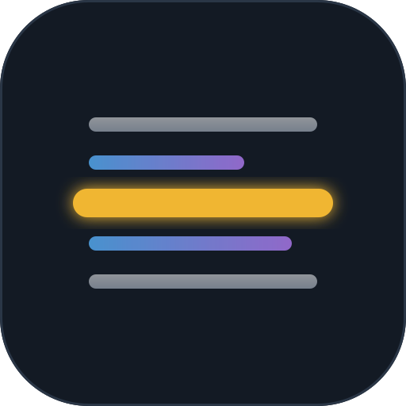
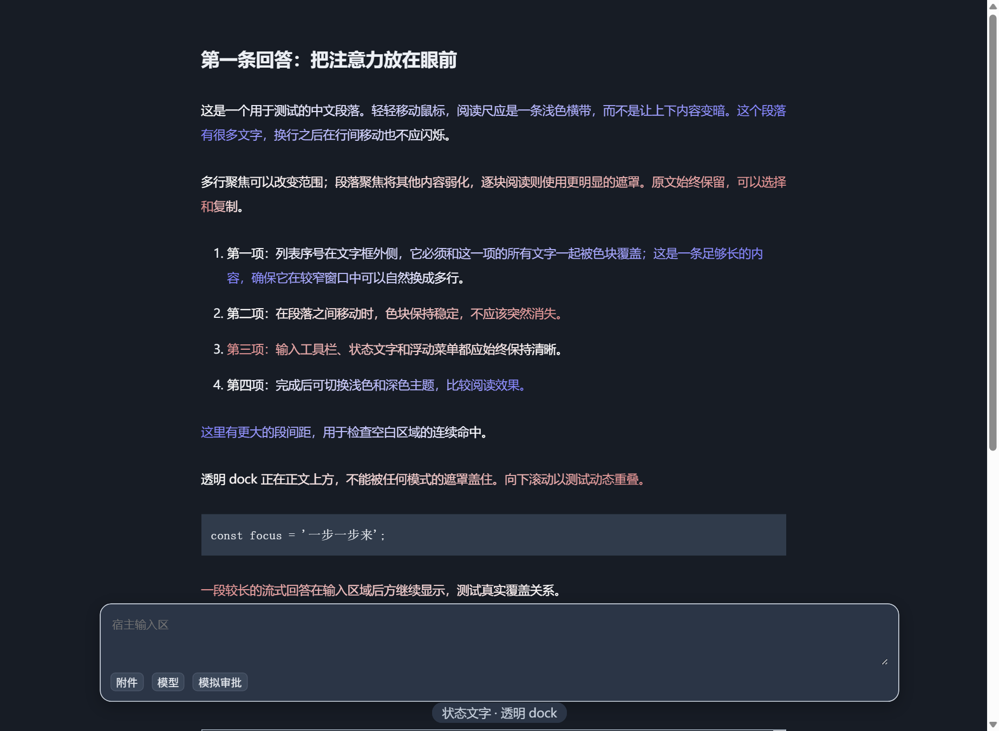
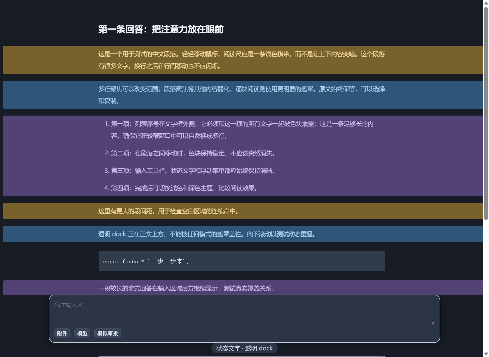
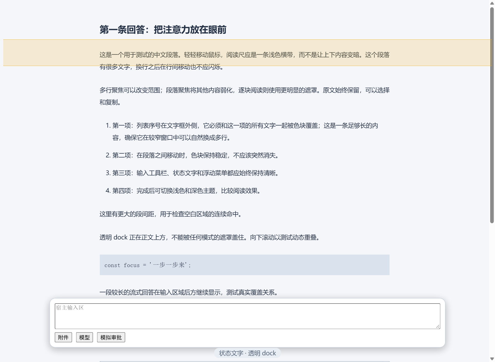
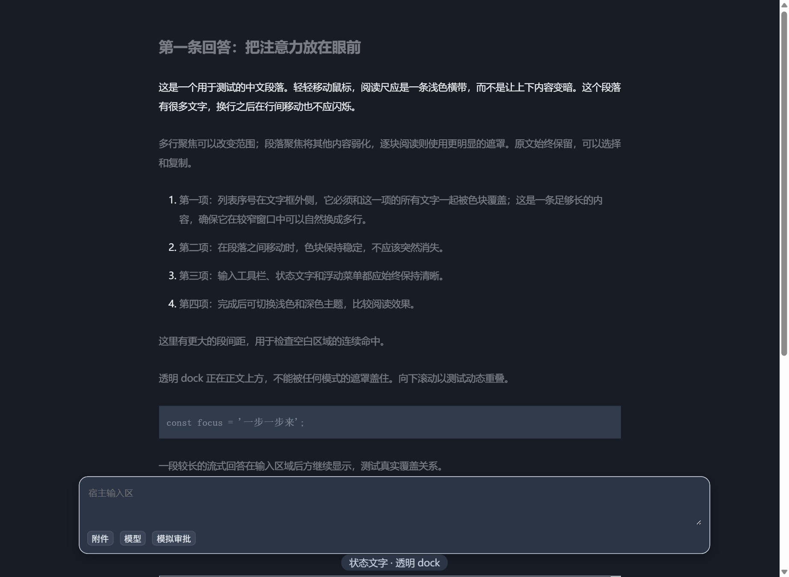

<p align="center"></p>

<h1 align="center">Reading Focus for DeepSeek Harness</h1>

<p align="center">Gradient text, a reading ruler, line and block focus, and colour bands for the DeepSeek Harness chat transcript.</p>

<p align="center">
  <a href="https://github.com/smallflycar/dsh-reading-focus"></a>
  <a href="https://www.npmjs.com/package/dsh-reading-focus"></a>
  <a href="https://github.com/smallflycar/dsh-reading-focus/releases"></a>
</p>

<p align="center">
  <a href="README.md">简体中文</a> · <a href="README.en.md">English</a>
</p>

## Why this exists

I spend more and more of my day in an agent. Its output is long and keeps piling up: an answer runs to a thousand words, and a few turns become screen after screen of transcript. The way I work with it is stop-start as well — send a task, wait, come back and keep reading. Reading that much text is tiring, and attention drifts.

Reading rulers, line focus and colour bands have existed in browsers for a long time, to make long text easier to read. Agent transcripts are longer and denser, and I think they need those aids more, so I brought a few of them into the DSH transcript.

## Features

- **Gradient reading** — gradient text that advances line by line, switching hue every two lines.
- **Reading ruler** — a faint band with a solid line on each edge, following the pointer.
- **Line focus** — the rows near the pointer stay clear while the rest is dimmed.
- **Block focus** — the current paragraph stays as it is and the rest fades or dims.
- **Colour bands** — adjacent passages separated by cycling colour blocks; code and headings stay plain.

## Screenshots



*Gradient reading: body text only, advancing line by line.*



*Colour bands: adjacent passages separated by cycling colours; code and headings stay plain.*



*Reading ruler: a faint band with a solid line on each edge.*



*Block focus: the current paragraph stays as it is, the rest fades or dims.*

*Screenshots come from the local preview page `preview.html` and are illustrative.*

## Install

**DSH Desktop**: open **Settings → Plugins → Add plugin**, enter `dsh-reading-focus`, install, then refresh the page.

**Command line**:

```bash
dsh plugin --profile <profile> add dsh-reading-focus
```

To install whatever npm currently publishes as latest — and skip the 24-hour cooldown described below — use this (needs `npm` on the machine):

```bash
dsh plugin --profile desktop add "dsh-reading-focus@$(npm view dsh-reading-focus version)"
```

The line contains no version number: `$(npm view …)` looks it up when you run it and installs that exact version. Copy it as is; it never needs editing.

Requires DSH 0.2.x. You can also install the tarball from the [latest release](https://github.com/smallflycar/dsh-reading-focus/releases/latest).

> A freshly published version is held back by pnpm's release cooldown (`minimumReleaseAge`, 24 hours by default): the usual "update" resolves a range and may still install the previous version. To get the new version immediately, name it — pick **Update to x.y.z** in the plugin's version list, or run `dsh plugin --profile desktop add dsh-reading-focus@x.y.z`. pnpm then records that version in `minimumReleaseAgeExclude` and skips the cooldown for it.

## Compatibility

| DSH version | Reading body | Markdown root | Status |
| --- | --- | --- | --- |
| 0.2.3-alpha.1 and later | `xMeOpW_body` | `<hash>_markdown` (e.g. `-TmMFa_markdown`) | ✅ tested on 0.2.3-alpha.2 |
| 0.2.2 rc line | `xMeOpW_body` | `_markdown_<hash>_<n>` | ✅ |
| 0.2.1 and earlier | `v5IAXa_body` | `_markdown_<hash>_<n>` | ✅ by structure, not tested |

Build hashes inside those class names are build artefacts and have nothing to do with the operating system; the plugin depends on neither the hash nor the order inside a class name:

- a reading body is a container whose class token ends in `_body`, that holds a markdown root directly, and that is not inside a non-`assistant-step` flow item (tool rows, command rows);
- a markdown root is a direct child whose class token contains `markdown`, so both `_markdown_<hash>_<n>` and `<hash>_markdown` are accepted;
- if a host renames the `body` local too, the plugin falls back to structure: the container of markdown roots inside a chat flow.

A DSH patch release, another machine or another OS therefore needs no selector update. The one case that still needs work is the host renaming the `markdown` local or moving markdown roots into another container.

## Changelog

**0.8.6** — adapts to the class-name change in DSH 0.2.3-alpha.1. That release moved `dsh-client-ui-primitives` into the frontend bundle, so the markdown root went from `_markdown_<hash>_<n>` to `<hash>_markdown` and the old selector found no reading block at all. Both orders and any hash are recognised now, and tool/command rows that also end in `_body` are kept out of the reading body.

**0.8.5** — stops hard-coding the body hash; the line-height override anchors on the plugin's own `data-reading-focus-body` marker and is removed together with the override.

## Usage

1. Open **Settings → Reading Focus** and turn on the switch.
2. Pick a mode; the panel shows only the controls that apply.
3. Use **Adjust in the transcript** to tune it while reading.
4. Everything is saved and restored on the next open.

Light and dark themes both work. Code, tables and headings are always left alone.

## Notes

- Switch between the five modes at any time; no need to reopen the conversation.
- Bug reports and suggestions are welcome in [Issues](https://github.com/smallflycar/dsh-reading-focus/issues).

## License

MIT. See [LICENSE](LICENSE).

[](https://github.com/deepseek-ai/deepseek-harness)
