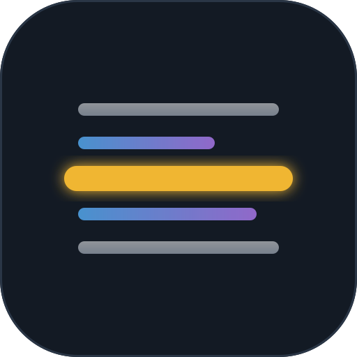
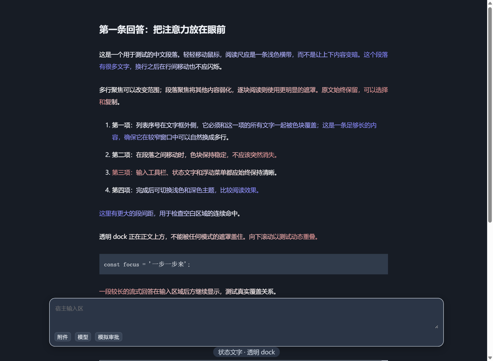
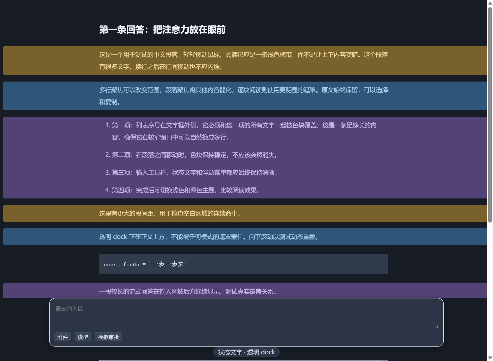

<p align="center"></p>

<h1 align="center">DSH 阅读辅助</h1>

<p align="center">在 DeepSeek Harness 的聊天正文里，提供渐变文字、阅读尺、行/段聚焦和色块分段。</p>

<p align="center">
  <a href="https://github.com/smallflycar/dsh-reading-focus"></a>
  <a href="https://www.npmjs.com/package/dsh-reading-focus"></a>
  <a href="https://github.com/smallflycar/dsh-reading-focus/releases"></a>
</p>

<p align="center">
  <a href="README.md">简体中文</a> · <a href="README.en.md">English</a>
</p>

## 为什么做这个

我每天在 Agent 里花的时间越来越长。它的输出很长，还会一直往后堆：一条回答上千字，聊几轮就是一整屏接一整屏的记录；用它的节奏又是断断续续的——发任务、等结果、再回来接着读。这种时候读长文容易累，注意力也容易散。

浏览器里早就有阅读尺、行聚焦、色块这类辅助，本来就是为了让长文读起来轻松一点。Agent 的正文更长、更密，我想这个场景更需要它们，所以把其中几种搬进了 DSH 的聊天正文。

## 功能

- **渐变阅读** —— 按视觉行推进的渐变文字，每两行换一次色相。
- **阅读尺** —— 跟随指针的一条淡色带，上下各一条实线。
- **多行聚焦** —— 指针附近的几行保持清晰，其余压暗。
- **段落聚焦** —— 当前段落保持原样，其余文字变淡或压暗。
- **色块分段** —— 相邻内容用轮换的色块分开，代码和标题保持原样。

## 截图



*渐变阅读：只给正文着色，逐行推进。*



*色块分段：相邻内容用轮换的色块分开，代码和标题保持原样。*


*阅读尺：跟随指针的淡色带，上下各一条实线。*


*段落聚焦：当前段落保持原样，其余内容变淡或压暗。*

*截图来自仓库自带的本地预览页 `preview.html`，仅作效果示意。*

## 安装

**DSH Desktop**：打开 **Settings → Plugins → Add plugin**，输入 `dsh-reading-focus`，安装后刷新页面。

**命令行**：

```bash
dsh plugin --profile <profile> add dsh-reading-focus
```

需要 DSH 0.2.x（已在 0.2.2-rc.5 上验证）。也可以从 [Release](https://github.com/smallflycar/dsh-reading-focus/releases/latest) 下载 tarball 安装。

## 使用

1. 打开 **设置 → 阅读辅助**，打开右上角开关。
2. 选一种效果，下面只出现它用得上的参数。
3. 想边读边调，点「在正文中实时调节」。
4. 所有设置都会自动保存，下次打开恢复上次的状态。

深浅主题都适配。代码、表格和标题始终保持原样。

## 说明

- 五种效果可以随时切换，不需要重开对话。
- 遇到问题或有建议，欢迎在 [Issues](https://github.com/smallflycar/dsh-reading-focus/issues) 里提。

## 许可证

MIT，详见 [LICENSE](LICENSE)。

[](https://github.com/deepseek-ai/deepseek-harness)
