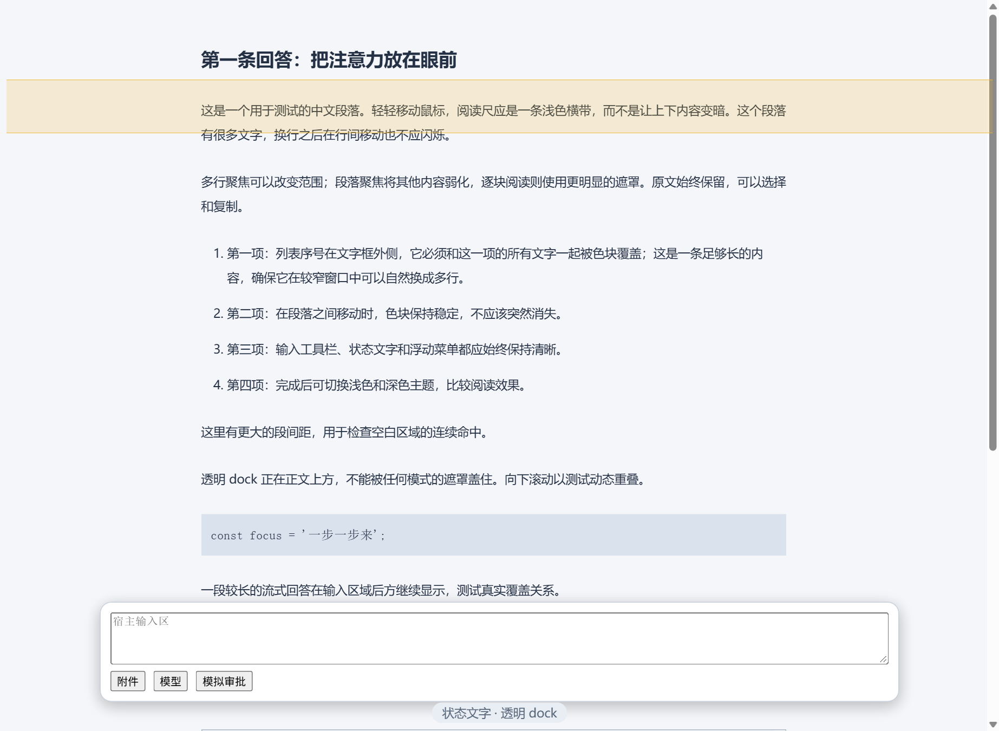
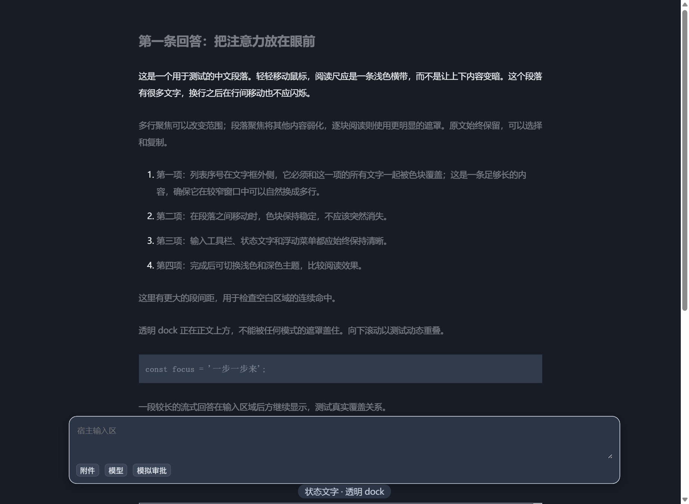

<p align="center"></p>

<h1 align="center">DSH 阅读辅助</h1>

<p align="center">在 DeepSeek Harness 的聊天正文里，提供渐变文字、阅读尺、行/段聚焦和色块分段。</p>

<p align="center">
  <a href="https://github.com/smallflycar/dsh-reading-focus"></a>
  <a href="https://www.npmjs.com/package/dsh-reading-focus"></a>
  <a href="https://github.com/smallflycar/dsh-reading-focus/releases"></a>
</p>

<p align="center">
  <a href="README.md">简体中文</a> · <a href="README.en.md">English</a>
</p>

## 为什么做这个

我每天在 Agent 里花的时间越来越长。它的输出很长，还会一直往后堆：一条回答上千字，聊几轮就是一整屏接一整屏的记录；用它的节奏又是断断续续的——发任务、等结果、再回来接着读。这种时候读长文容易累，注意力也容易散。

浏览器里早就有阅读尺、行聚焦、色块这类辅助，本来就是为了让长文读起来轻松一点。Agent 的正文更长、更密，我想这个场景更需要它们，所以把其中几种搬进了 DSH 的聊天正文。

## 功能

- **渐变阅读** —— 按视觉行推进的渐变文字，每两行换一次色相。
- **阅读尺** —— 跟随指针的一条淡色带，上下各一条实线。
- **多行聚焦** —— 指针附近的几行保持清晰，其余压暗。
- **段落聚焦** —— 当前段落保持原样，其余文字变淡或压暗。
- **色块分段** —— 相邻内容用轮换的色块分开，代码和标题保持原样。

## 截图


*渐变阅读：只给正文着色，逐行推进。*


*色块分段：相邻内容用轮换的色块分开，代码和标题保持原样。*



*阅读尺：跟随指针的淡色带，上下各一条实线。*



*段落聚焦：当前段落保持原样，其余内容变淡或压暗。*

*截图来自仓库自带的本地预览页 `preview.html`，仅作效果示意。*

## 安装

**DSH Desktop**：打开 **Settings → Plugins → Add plugin**，输入 `dsh-reading-focus`，安装后刷新页面。

**命令行**：

```bash
dsh plugin --profile <profile> add dsh-reading-focus
```

需要 DSH 0.2.x。也可以从 [Release](https://github.com/smallflycar/dsh-reading-focus/releases/latest) 下载 tarball 安装。

> 刚发布的新版本会受 pnpm 的发布冷却（`minimumReleaseAge`，默认 24 小时）影响：不写版本号时可能仍装到上一个版本。想立刻用新版，装确切版本号，例如 `dsh plugin --profile desktop add dsh-reading-focus@0.8.6`；pnpm 会为该版本自动加一条 `minimumReleaseAgeExclude`，不受冷却限制。

## 兼容性

| DSH 版本 | 正文容器 | Markdown 根 | 状态 |
| --- | --- | --- | --- |
| 0.2.3-alpha.1 及以后 | `xMeOpW_body` | `哈希_markdown`（如 `-TmMFa_markdown`） | ✅ 0.2.3-alpha.2 实测 |
| 0.2.2 rc 系列 | `xMeOpW_body` | `_markdown_哈希_序号` | ✅ |
| 0.2.1 及更早 | `v5IAXa_body` | `_markdown_哈希_序号` | ✅ 结构识别，未实机 |

宿主类名里的哈希是构建产物，和操作系统无关；插件不依赖具体哈希，也不依赖类名里的顺序：

- 正文容器认「类名以 `_body` 结尾、直子含 Markdown 根、且不在工具行等非 `assistant-step` 流项目里」；
- Markdown 根认「类名含 `markdown`、且是正文容器的直子」，`_markdown_哈希_序号` 和 `哈希_markdown` 两种都接受；
- 万一宿主连 `body` 这个局部名都改了，退回结构识别：聊天流里包裹 Markdown 根的容器。

所以 DSH 小版本升级、换机器、换系统都不需要重新适配。唯一还需要人工介入的情况是宿主改了 `markdown` 这个局部名，或把 Markdown 根挪进别的容器。

## 更新记录

**0.8.6** —— 适配 DSH 0.2.3-alpha.1 起的类名变化。那一版把 `dsh-client-ui-primitives` 改为随前端 bundle 构建，Markdown 根从 `_markdown_哈希_序号` 变成 `哈希_markdown`，旧选择器因此一个正文块都找不到。现在两种顺序、任意哈希都认；同时区分正文容器与工具行、命令行那类同样以 `_body` 结尾的容器。

**0.8.5** —— 不再写死正文容器的哈希；行高覆盖规则改挂在插件自己写的 `data-reading-focus-body` 标记上，清除覆盖时一并移除。

## 使用

1. 打开 **设置 → 阅读辅助**，打开右上角开关。
2. 选一种效果，下面只出现它用得上的参数。
3. 想边读边调，点「在正文中实时调节」。
4. 所有设置都会自动保存，下次打开恢复上次的状态。

深浅主题都适配。代码、表格和标题始终保持原样。

## 说明

- 五种效果可以随时切换，不需要重开对话。
- 遇到问题或有建议，欢迎在 [Issues](https://github.com/smallflycar/dsh-reading-focus/issues) 里提。

## 许可证

MIT，详见 [LICENSE](LICENSE)。

[](https://github.com/deepseek-ai/deepseek-harness)
