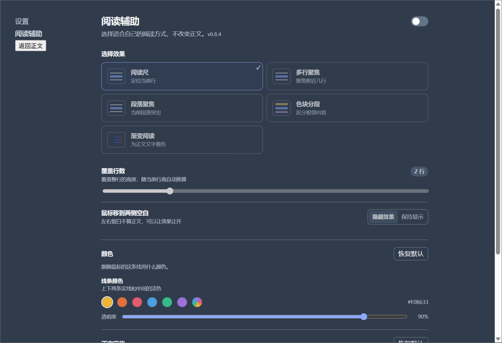
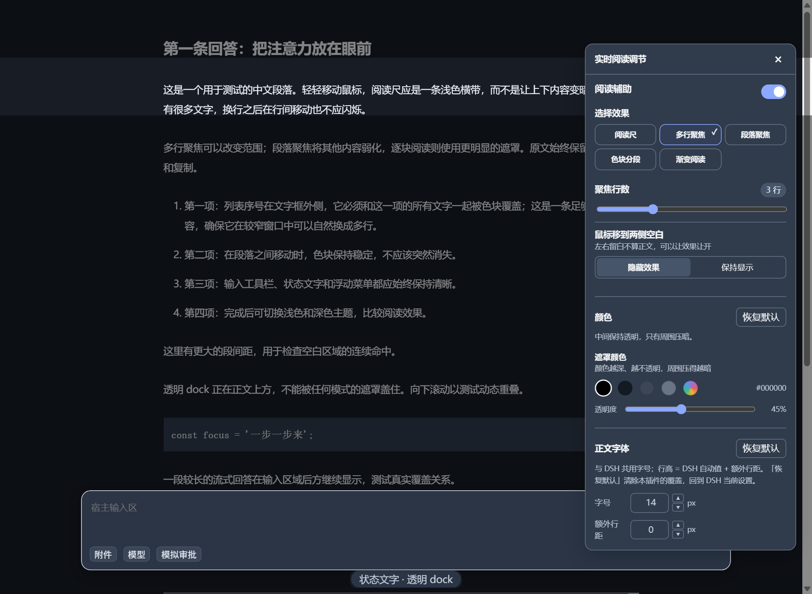

<p align="center"></p>

<h1 align="center">DSH 阅读辅助</h1>

<p align="center">给 <a href="https://www.deepseek.com/">DeepSeek Harness</a> 的阅读增强层：渐变文字、阅读尺、逐行与逐段聚焦、色块分段。</p>

<p align="center">
  <a href="https://github.com/smallflycar/dsh-reading-focus"></a>
  <a href="https://github.com/smallflycar/dsh-reading-focus/releases"></a>
  <a href="LICENSE"></a>
  
  
  <a href="README.en.md"></a>
</p>

> 所有效果都只做视觉叠加：不修改正文、不插入文字节点、不影响选择和复制。

## 为什么做这个

聊天正文越写越长，很容易在行与行之间迷失。这个插件把几种常见的「把注意力放回当前这一行」的阅读方式做成可以随时切换的视觉层：

- 鼠标划过哪一行，就用一条淡色带或一条清晰的窗口把它框出来；
- 想读完整段时，让其余内容退到后面，当前段落保持原样；
- 想一眼看清结构时，用轮换的色块把相邻内容分开；
- 想给正文上色时，用逐行推进的渐变代替满屏黑字。

全部是纯视觉叠加，原文、选区、复制、查找都不受影响。

## 安装

### DSH Desktop

打开 **Settings → Plugins → Add plugin**，输入包名 `dsh-reading-focus` 安装，然后刷新页面。替换已安装的 JavaScript 需要重启 DSH。

### 命令行

```bash
dsh plugin --profile <profile> add dsh-reading-focus
```

包尚未发布到 npm，或想不经过 npm 安装时，可以直接用 GitHub Release 里的 tarball：

```bash
dsh plugin --profile <profile> add https://github.com/smallflycar/dsh-reading-focus/releases/download/v0.8.4/dsh-reading-focus-0.8.4.tgz
```

或者用本地构建：

```bash
npm run build && npm run pack
dsh plugin --profile <profile> add ./dist/dsh-reading-focus-0.8.4.tgz

# 开发时直接链接源码目录
dsh plugin --profile <profile> add "link:/absolute/path/to/this/repo"
```

安装后在「设置 → 阅读辅助」开启。`link:` 方式改完源码后重新 `npm run build` 并重新加载插件即可。

## 界面

|  |  |
|---|---|
|  |  |
| **设置面板**：按「效果 → 参数 → 颜色 → 字体」分节，只显示当前模式用得上的控件 | **渐变阅读**：只给正文着色，逐行交替推进 |
|  |  |
| **色块分段**：整段轮换色相，代码块与标题不上色，表格照常分段 | **阅读尺**：上下实线 + 淡色带，跟随指针 |
|  |  |
| **段落聚焦**：当前段落保持原样，其余内容变淡或压暗 | **悬浮调节窗**：在正文里实时调节，不打断阅读 |

截图来自仓库自带的本地夹具（`preview.html`），用于说明视觉效果，不是真实 DSH 界面的像素证据。

## 五种效果

| 模式 | 中间 | 其余内容 | 可调 |
|---|---|---|---|
| 阅读尺 | 淡色带 + 上下实线 | 不变暗 | 线条颜色、覆盖行数 1–6 |
| 多行聚焦 | 完全透明、正常亮度 | 遮罩压暗 | 遮罩颜色、聚焦行数 1–8 |
| 段落聚焦 | 当前段落保持原样 | **文字变淡** 或 **遮罩压暗**（可切换） | 遮罩/底色、透明度 |
| 色块分段 | 轮换的三种色块 | — | 配色方案、浓度；自定义时三个取色器 |
| 渐变阅读 | 逐行推进的渐变文字 | — | 配色、颜色强度 |

## 细节与边界

### 渐变阅读

渐变按**视觉行**推进，每行独立走完一段，方向交替：

```
第 0 行 底色 → 色A      第 1 行 色A → 底色
第 2 行 底色 → 色B      第 3 行 色B → 底色   （此后循环）
```

相邻两行的衔接永远落在**两个极值**上——要么都是满饱和的色A/色B，要么都是纯底色——不会停在渐变中段。这一点很重要：换行处若恰好是淡色，颜色就无法把视线从上一行带到下一行。每两行换一次色相（A、B 交替）。

只有一个着色字形的行使用进入该行时的颜色，并且不推进模式，所以它不会破坏前后任一衔接点；该行本身不呈现渐变。同一回答中的全部 Markdown 根节点共享行的推进序号，**包括被工具调用隔开的两段**：宿主把工具调用前后的正文渲染成不同的根节点，但打印出来仍是同一段连续阅读，所以颜色会跨过工具卡片继续推进，而不是从底色重新开始。真正的新回答（`data-chat-turn` 变化）仍然从底色重新开始。视觉行由矩形重叠近似分行，混合字号的复杂布局仍可能误判。

只有**正文文字**着色：`h1`–`h6` 标题、`code`/`pre` 代码、表格、图片、按钮等控件一律保留原色。大字号标题若参与着色，单个字形就会占满一整段渐变，看起来是渲染异常而不是阅读辅助。链接等不着色内容不保证端点连续。

使用浏览器原生的 CSS Custom Highlight，不改变 DOM。启用时优先处理视口附近的回答，同一回答内按前后顺序分帧处理所有已加载、可布局的正文块；每帧最多 400 个步骤、约 4ms 软预算（浏览器调用不可抢占），首次长文处理会耗时且占用内存。已处理块在连接期间缓存，滚动本身不重测；流式变化按块更新，前文行数引起进度变化时复用后文几何重新着色；字体、主题、宽度变化重新测量。浏览器不支持 CSS Custom Highlight 或系统强制颜色启用时提示并保留原色。

### 阅读尺与多行聚焦

两者都独立锚定当前会话的阅读 pane 与滚动区，不要求鼠标命中正文块；代码、代码标题与复制按钮、横向滚动区、表格、图片和段落间空白都可以跟随。

- **阅读尺**由上下两条实线和中间的淡色带组成，宽度优先对齐当前 pane 的宽度控件内侧，否则使用 pane 宽度，并受 pane 与视口裁剪。行高按当前正文真实行高换算整数行，覆盖 1–6 行。
- **多行聚焦**让指针附近一条横向区域保持完全透明，其余压暗；行数 1–8，按固定 24px 基准行高估计并留少量余量，不随具体字体或鼠标命中的元素变化。

两种模式在同会话的宽度手柄、输入区域或任务控件上冻结最后阅读位置；拖动宽度手柄不抢夺原生 pointer capture，松开后按指针位置恢复；离开会话或进入菜单时清除。输入卡与任务卡按计算出的四角半径保护，统计读数合并为一条清晰区域；菜单、列表框与对话框受保护。仅有会话与滚动标记的 pane 支持这些 pointer 模式。

### 段落聚焦

当前段落保持原样，其余内容有两种呈现方式：

- `文字变淡` 用 `CSS.highlights` 的 `::highlight()` 直接改文字颜色，颜色取当前正文色并降低不透明度，深浅主题都自动适配，页面不加任何遮罩；
- `遮罩压暗` 盖一层压暗遮罩，并给当前段落可选底色。

不支持 CSS Custom Highlight 的浏览器自动退回遮罩压暗。指针短暂离开正文（例如划过工具调用行）时保留上一帧，再回到正文立即恢复。

### 色块分段

可选「整段色块」或「紧凑色带」；两种都把整个列表（包括嵌套列表、序号、多行和项间空白）作为同一色块。颜色按整个回答轮换，被工具调用拆成多段时不会连续出现同一颜色。

- **代码块不上色**：`pre`、`[data-code-block-content]` 与 `.md-code-block` 既不参与分段，也作为屏障阻止相邻色块跨过它合并，代码保留自身的表面与语法色。
- **标题不上色**，与渐变保持一致；**表格**和普通段落一样参与分段。
- 相同阅读 lane 的相邻同色色块在相接或最多 1px 残余缝隙时合并；不同色的间距不剪切文字。大于 24px 的原始间隙、可识别过程/工具卡和图片不跨越。
- 透明交互层、空容器和隐藏辅助元素不再仅因有矩形就作为色块屏障；有内容的普通流子节点可作为屏障，与正文重叠时保守不裁正文，明确的图片保留裁剪。

### 正文字体

字号与 DSH 共用同一个变量 `--dsh-content-font-size`，范围 **10–22px**、默认 **14px**——面板里的值和 DSH 设置里的值是同一个。

DSH 的行高不是倍数，而是「字号 + 10px」的阶梯（14→24、16→26、18→28）。插件不重写这条阶梯，只提供 **0–12px 的「额外行距」**：

- 0 表示完全按 DSH 的行高，插件不写任何覆盖规则；
- 大于 0 时写入 `calc(24px + var(--dsh-content-font-delta, 0px) + Npx)`，宿主改字号时行距自动跟随；
- 「恢复默认」**清除插件的覆盖**，把字号交还给 DSH 当前设置，而不是写入 14px。

插件关闭期间 DSH 改了字号，重新开启或打开面板时会先读回宿主值。

### 设置、窗口与快捷键

点击「在正文中实时调节」关闭设置并打开悬浮窗。拖动标题栏移动；× 或窗口内 Esc 只关闭窗口，不关闭效果；在正文上按 Esc 会关闭效果本身，输入框内不拦截快捷键。宿主模态框优先，出现时隐藏效果与悬浮窗。

设置（含开关状态）保存在浏览器 localStorage，下次打开按上次的状态恢复。旧版鼠标聚光灯模式会回退到阅读尺，旧版行距配置会换算成「额外行距」，其他偏好保留。

## 兼容性

插件依赖 DSH 的私有结构：`.xMeOpW_body` 直子中符合 `_markdown_[字母数字]_[数字]` 的 Markdown 根、`data-chat-turn`、`data-slot="conversation.chat.flow"`、`data-composer-*` 等标记。已确认 rc.1 的 `_markdown_rve47_5` 与 rc.3 的 `_markdown_13jw0_5`；仅 hash 变化的类名仍兼容，body 类或宿主结构变化可能需要重新适配，不承诺其他结构。

`package.json` 的 `engines.dsh` 声明了测试过的范围（`>=0.2.2-rc.3 <0.3.0`）；DSH 升级后请先在新版本里复核效果。插件不读取认证信息，不修改 profile。

## 开发

```bash
npm run build                  # src/*.js → lib/client.js、lib/index.js、preview.html
npm test                       # 构建 + 17 项逻辑、结构、产物一致性断言
npm run test:browser           # 无头 Chrome：19 项渲染断言（需要本机 Chrome）
npm run test:browser:geometry  # 无头 Chrome：7 项分段几何断言
npm run pack                   # 生成 dist/dsh-reading-focus-<version>.tgz
```

`lib/client.js`、`lib/index.js` 和 `preview.html` 由 `build.mjs`（渲染规则在 `build-lib.mjs`）生成，不要直接编辑。`npm test`、浏览器测试和打包前都会先构建；测试还会逐字比较产物与 `src` 的渲染结果，改了源码没重新生成会直接失败。`preview.html` 和 `docs/screenshots` 是本地夹具，不是真实 GUI 像素证据。

测试目录里，`plugin.test.mjs` 覆盖逻辑与产物，`browser-validation.mjs` 覆盖各模式的渲染与交互，`conversation-regression.mjs` 覆盖被工具调用拆段时的分段几何（DPR、间距、隔离与屏障）。


## 更新记录

0.3.5 兼容已确认的 rc.1 `_markdown_rve47_5` 和 rc.3 `_markdown_13jw0_5`，并支持仅 hash 变化且仍符合 `_markdown_[字母数字]_[数字]` 的类。识别限定私有 `.xMeOpW_body` 的直子；body 类或宿主结构变化仍可能需要重新适配，不承诺其他结构。插件使用官方 `settings.section` 和共享 React。插件不读取认证信息，不修改 profile。

0.3.7 修正多行模式的绘制层级：会话 composer seat 为 sticky、z-index 9，背景从透明渐变到实色；旧遮罩 z-index 4 因此绘制在其背后，即使几何区域覆盖整个 pane 也不能压暗座位背景。仅多行遮罩提升至 10，其他效果仍为 4，调节窗为 1000；不修改宿主样式。输入卡按 `data-composer-card` 的实际矩形保护；上方任务卡按宿主 `section[data-testid="todo-panel"]` 整体保护，包含背景和展开内容，随尺寸变化重算。下方 `data-composer-dock` 是状态行而非任务卡，不豁免整宽 seat。菜单等仍保留独立保护。任务卡标记属于宿主实现细节，未来版本改变可能失效。

0.4.4 渐变进度模型改为「每行独立走完一段、方向交替」，相邻行衔接落在满饱和或纯底色两个极值上，不再停在渐变中段；同时渐变与色块都不再作用于标题、代码块与表格。

0.5.0 颜色跨工具调用继续推进：同一回答里被工具卡片隔开的两段正文不再各自从底色重新开始，只有真正的新回答才重置。设置面板标题下显示版本号，便于确认加载的是哪一次构建。

0.6.0 一次较大的交互与性能改版：

- 色块分段改为按整段回答轮换色相，工具调用把回答拆成多段时不再连续出现同一颜色。
- 滚动跟随不再复用滚动前的命中目标，遮罩与色块随文字同步移动，不再滞后一拍再跳回。
- 多行聚焦在鼠标位于输入框或状态栏时不再绘制横杠，改为整体提亮，输入框保持完整。
- 阅读尺与多行聚焦都按当前正文真实行高换算整数行，字体或行距变化后仍与文字对齐；阅读尺改为可覆盖 1–6 行。
- 段落聚焦在指针短暂离开正文（例如划过工具调用行）时保持上一帧，不再闪烁消失。
- 新增正文字号、字重、行距调节，直接写入宿主排版变量，与 DSH 自带设置双向同步。
- 新增各模式强调色与不透明度调节，提供六个预设色与自定义取色。
- 移除渐变模式下的「就绪 · 已着色 N 段」状态文字，该面板不再出现调试式读数。
- 渐变着色不再为每个字形重复读取正文块的边界矩形，进度状态也不再每帧遍历全部段落。

0.6.3 把重复的「段落聚焦」和「逐块阅读」合并成一个模式：两者本来就选中同一个块、只是变弱方式不同，现在只保留一张卡片，用「其余内容」在 `文字变淡` 和 `遮罩压暗` 之间切换，各自的调节项随之变化。模式数从 6 减到 5，旧配置里的 `paragraph` 模式与配色自动迁移到合并后的模式。

0.6.4 重做设置面板：按「选择效果 / 该效果的参数 / 颜色 / 正文字体」分节，去掉对当前模式无效的控件（「效果强度」只属于渐变阅读）；每个颜色槽位有自己的推荐色板——线条用醒目色、压暗遮罩用深色中性、色块用柔和底色，不再共用一套从黄色排起的色板；新增自定义取色与按模式独立的「恢复默认」。

0.6.5 阅读尺和多行聚焦在指针移到正文两侧留白时让开，整页恢复可见；用正文列实际边界加 10px 缓冲与 110ms 延迟，拖动宽度手柄不会闪烁。可在设置里改回「保持显示」。

0.7.0 设置面板继续收敛：色板按用途缩短（压暗遮罩 4 色、段落底色 4 色、色块 4 色，只有阅读尺保留 6 色）；色块分段改为「配色方案 + 浓度」，自定义方案才展开三个取色器；取色换成面板内的色相/饱和/明度滑块；字重改为直接作用于正文段落（此前写在包裹层上，继承无法覆盖渲染器自己的声明，所以拖了没反应）；开关状态随其他偏好一起保存，重启后不再需要重新打开。

0.7.1 交互再调：渐变阅读的配色改成三条渐变色「胶囊」，直接显示那一组颜色，不再用文字下拉；自定义取色换成点选式色板（三档明度的色相网格 + 中性色），去掉色相/饱和/明度这类专业术语；字号、字重、行距、覆盖行数改为数字输入框加 ▲▼ 按钮，和 DSH 自己设置里的字号控件一致，减少需要拖动的滑块。

0.7.2 自定义取色改为色盘：一个圆盘（角度是色相、离圆心远近是饱和）、一个明度滑块、一个透明度滑块和一个可直接输入的十六进制色值；预设色板不再塞满一屏没人要的颜色。去掉字重设置——DSH 的字体粗细由内容语义决定，插件改它只会和宿主打架，而且实测在不同字体下表现不一致。

0.7.3 渐变配色胶囊只显示那一组的两个色相（左边一个色、右边一个色），不再把底色黑/白混进去，之前看着像一条黑条。

0.7.4 取色器改为在色块下方就地展开，不再是一个会自己消失的浮层；去掉重复的「透明度」——透明度仍然由下面那条「压暗程度 / 浓度」滑块负责，取色器只负责颜色本身。「覆盖行数 / 聚焦行数」改回滑块：它是 1–6 这种小范围整数，拖动比输入更快；字号和行距继续用数字框加 ▲▼。

0.7.5 压暗遮罩的默认色改为纯黑（原来是偏蓝的深灰，铺在白底上会发蓝）；去掉「上一块 / 下一块」按钮和 Alt+↑/↓ 逐块跳转——鼠标移动本来就会切换当前段落，手动步进没有额外价值；自定义取色的入口改成完整的彩虹圆盘，之前中间留白只剩一圈暗环。

0.7.6 色卡圆点不再露出方形底：Chromium 会把 `background` 铺满按钮的方框而不按 `border-radius` 裁剪，导致圆点四角冒出方块、中间还压着一层浅色。改为把颜色画在内部元素上、由它自己裁成圆形，圆点与彩虹盘现在都是干净的圆。

0.7.7 透明度不再是无级滑块，改成有意义的档位：压暗程度「轻 / 中 / 重」、淡出程度「轻 / 中 / 重」、色块浓度「淡 / 中 / 明显」、段落底色「淡 / 中 / 浓」。原来的滑块能拖到「完全没效果」或「什么都看不见」，那不叫可调，叫没有边界。每档都落在仍然可用、仍然能读的区间内；段落聚焦因为本来就高亮当前块，使用更轻的一档压暗。

0.7.8 多行聚焦去掉「遮罩颜色」：遮罩必须够深才压得暗，能选的颜色其实只剩「多深」这一个维度，和「轻 / 中 / 重」重复；而且浅色遮罩在深色主题下会把周围提亮，与「压暗」相反。压暗统一用黑色，只留三档强度。段落聚焦同理，只保留「压暗程度」和「当前段落底色」——后者是加亮当前块，颜色有意义。

0.7.9 纠正上一版的方向：该删的是重复的档位，不是遮罩颜色。「压暗」现在只有一个控件——遮罩颜色，颜色本身带透明度：色板提供从纯黑到浅灰的四档，取色器里的「透明度」在 15%–85% 之间连续调节，越深越不透明就压得越暗。段落聚焦的「当前段落底色」同样把强度并进取色器，不再单独列一档。

0.8.0 统一成一条规则：**一个可调项只出现一次，颜色的强度放在颜色自己的取色器里**。于是所有档位按钮取消，改成滑块；带颜色的效果不再有第二个强度控件：

| 效果 | 控件 | 强度范围 |
|---|---|---|
| 阅读尺 | 线条颜色（取色器内调透明度） | 30%–100% |
| 多行聚焦 | 遮罩颜色（取色器内调透明度） | 15%–85% |
| 段落聚焦 · 遮罩压暗 | 遮罩颜色（透明度 15%–70）＋ 当前段落底色（5%–40） | 同上 |
| 段落聚焦 · 文字变淡 | 其余文字透明度（滑块，没有颜色） | 25%–85% |
| 色块分段 | 配色方案 ＋ 色块浓度（滑块，三个色块共用一层浓度） | 10%–45% |

下限保证「调到头也看得见效果」，上限保证「调到头也还读得懂」。

0.8.1 透明度从取色器里挪回到取色器外面，作为颜色下方独立的一行滑块。原因很实际：预设色点不会打开取色器，如果强度只藏在取色器里，选完预设色就找不到地方调轻重了。现在颜色（色点或自定义）与强度（透明度滑块）相邻，谁都能直接调。

0.8.2 三处布局修正：第五个模式卡片不再被拉成整行（五个卡片一样大小）；「鼠标移到两侧空白」的开关不再撑满一整条，恢复成紧凑的两个按钮——之前 `.floating` 前缀丢了，导致这两行变成上下堆叠；新会话还没有任何消息时不再绘制效果，等出现正文后才开始工作。

0.8.3 修掉一批「行为和承诺不一致」的问题：

- 开关状态真正落盘。以前只有别的控件顺手调用保存时才会带上它，关掉后重启又自动打开；现在保存字段只有一份清单，`enabled` 随开关立即写入。
- 字号、行距的数字框可以正常打字了。以前每敲一个键就钳制并回写，输「18」会依次变成 12 和 22；现在输入时只在数值合法时预览，失焦或回车才钳制落定，▲▼ 仍然可用。
- 行距回读不再静默改值。字号 22 / 行距 16 这类合法组合，以前存成比值后会被 1.0–2.0 的旧区间夹成 22；现在可接受区间与面板的 px 范围由同一组常量推导。
- 色块分段不再涂标题（`h1`–`h6`），表格和段落一样参与分段。
- `npm test` 与打包前都会先构建；测试逐字比较 `lib/client.js`、`lib/index.js`、`preview.html` 与 `src`，不再只检查几个函数名是否还在。
- 清理：删除未被任何脚本引用且恒失败的 `test/engine-simulation.mjs`，修好并接入 `test:browser:geometry` 的 `conversation-regression.mjs`（原断言写的是 0.6.0 已取消的同色合并），一次性 Python 像素检查移到 `tools/`，`.gitignore` 覆盖测试产生的浏览器 profile，残留 profile 目录已清理。
- 排版写入可回收：插件卸载时删除 `#rf-typography` 并还原宿主变量；DSH 自己改字号时面板会跟着更新，不会再拿旧值覆盖。
- 去掉只写不读的 `state.strength`、未使用的 `RF_BAND_PALETTE`、`shapeCount`、`rfLinePieces` 和未用的 `moved` 变量；渐变与色块模式滚动时不再做无人消费的段落命中测试。

0.8.4 正文字体改成和宿主同一套模型：

- 字号范围对齐 DSH 自己的字号控件：**10–22px，默认 14**（之前是 12–22，宿主设成 10/11 时一按箭头就跳档）。
- 行距不再存"比值"，也不再是独立的一段固定 px。DSH 的行高是 `24px + (字号 − 14)` 的阶梯（14→24、16→26、18→28），插件现在只提供**额外行距 0–12px**，加在这条阶梯之上；0 表示完全按 DSH 的行高，不写任何覆盖规则。规则本身用的是 `calc(24px + var(--dsh-content-font-delta, 0px) + 额外值)`，所以宿主改字号时行距自动跟着走，不会再出现"22 号字配 24 行高"的漂移。
- 旧配置自动迁移：0.8.3 及更早存的比值（或更早的 px）会换算成"相对宿主阶梯的额外值"。例如 18px 字号存了 24/14 的比值（30.86px），迁移后是 28px + 3px，渲染高度不变。
- 「恢复默认」改成**清除插件的覆盖**，把控制权还给 DSH 当前设置；之前它会直接写入 14px/24px，把用户在 DSH 里改过的字号盖掉。
- 插件关闭期间 DSH 自己改了字号，重新开启或打开面板时会先读回宿主值；面板提示也改成实际行为（共用字号、行高 = 自动值 + 额外值）。
- 打包脚本会先创建 `dist/`，干净检出下 `npm run pack` 不再报 `ENOENT`；测试新增两条保护：面板版本必须等于 `package.json` 版本，生成后的 `lib/client.js` 必须能被解析。
- 仓库整理（0.8.4 发布时）：一次性像素检查脚本与旧版本截图移出仓库，不进版本库；新增 `icon.svg`、`docs/screenshots`、双语 README、Issue/PR 模板与 `engines.dsh` 声明。

## 许可证

MIT。见 [LICENSE](LICENSE)。

